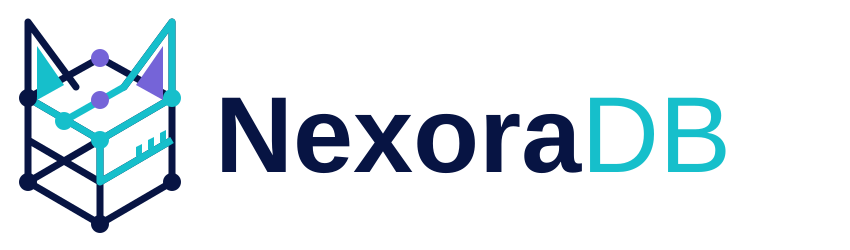

<picture>
  <source media="(prefers-color-scheme: dark)" srcset="frontend/public/brand/nexoradb-logo-dark.svg" />
  
</picture>

# NexoraDB — Document & Graph Database

### Open-source C++20 / RocksDB database with NexoraQL and Python

**C++20 engine · RocksDB storage · Graph projections · NexoraQL · Python API**

[Overview](#what-is-nexoradb) · [Installation](#installation) · [Quick start](#quick-start) · [NexoraQL](#nexoraql) · [Dashboard](#dashboard-and-cli) · [Research](#research-and-benchmarks) · [Contributing](#contributing)

Release 0.4.1: [changes and upgrade precautions](docs/releases/v0.4.1.md).
Wheel target: **Linux x86_64, CPython 3.10**; see the release notes for platform details.

> **Experimental / Alpha.** NexoraDB is an open-source research project focused on
> measurable performance, data correctness, resource control, and document-and-graph
> workflows. Review [current limitations](#current-limitations) before choosing a workload.

## What is NexoraDB?

NexoraDB combines a document engine, a graph subsystem, and **NexoraQL**, its
SQL-like query language. Applications can use the native Python API directly,
execute NexoraQL locally, or connect through the HTTP API, dashboard, and CLI.

- **Documents:** JSON-style records stored through a versioned BSON representation
  in RocksDB, with CRUD, secondary indexes, schema checks, and explicit transactions.
- **Relationships:** collection mappings build graph projections for traversal,
  graph algorithms, and COO/CSR export.
- **NexoraQL:** one language for document operations, graph definitions,
  traversal, transactions, diagnostics, and algorithm dispatch.

The project investigates performance and usability in selected workloads.
Results are scoped to measured configurations; universal superiority over other
database engines is not claimed.

## Installation

### Python package

Use a Python 3.10 virtual environment on a supported Linux x86_64 system.
WSL uses the Linux wheel; this is not a native Windows package.

~~~bash
python3.10 -m venv .venv
source .venv/bin/activate
python -m pip install --upgrade pip
pip install NexoraDataBase
~~~

To select this source version explicitly once its wheel is published:

~~~bash
pip install NexoraDataBase==0.4.1
~~~

The distribution is named **NexoraDataBase**; the import is **nexoradb**:

~~~bash
python -c "import nexoradb; print(nexoradb.__version__); print(nexoradb.build_info())"
~~~

For the optional BSON client, install the **binary** extra:

~~~bash
pip install 'NexoraDataBase[binary]'
~~~

The extra requires PyMongo 4.18.3 or later in the supported 4.x range.
The native engine uses libbson; MongoDB Server is not required to run NexoraDB.

### Build from source

Prerequisites: a C++20 compiler, CMake 3.22+, Python 3.10 development headers,
and the prerequisites in the [build guide](docs/cpp/BUILD_TEST_BENCHMARK.md).

~~~bash
git clone https://github.com/BlackProgrammer-prog/NexoraDB.git
cd NexoraDB

git clone https://github.com/microsoft/vcpkg.git vcpkg
git -C vcpkg checkout 7476f0d4e77d3333fbb249657df8251c28c4faae
./vcpkg/bootstrap-vcpkg.sh -disableMetrics

python3.10 -m venv .venv
source .venv/bin/activate
python -m pip install --upgrade pip setuptools wheel

cmake --preset release -DPython_EXECUTABLE="$(command -v python)"
cmake --build build/release --target nexoradb_py nexora_doc_tests nexora_graph_tests --parallel 2

install -Dm755 nexoradb.cpython-310-*.so \
  NexoraDB/src/nexoradb/native/nexoradb.cpython-310-x86_64-linux-gnu.so
python -m pip install ./NexoraDB
~~~

Build native libraries and the Python package from the same source version.
Sanitizer and profiling presets are available in `CMakePresets.json`.
Run installed-package examples from outside the repository root: a build-tree
`nexoradb*.so` there can shadow the installed `nexoradb` package.

## Quick start

Execute **NexoraQL through the installed Python package**. This example uses an
isolated temporary database, explicitly selects durable document writes, and
closes the engine after use.

~~~python
import json
from pathlib import Path
from tempfile import TemporaryDirectory

import nexoradb
from nexoradb.parser import Executor

with TemporaryDirectory(prefix="nexora-demo-") as directory:
    settings = nexoradb.RocksSettings()
    settings.durability = nexoradb.DocumentDurability.Durable
    engine = nexoradb.DocEngine(str(Path(directory) / "db"), rocks_settings=settings)
    query = Executor(engine)

    try:
        query.execute_text("CREATE COLLECTION users;")
        query.execute_text(
            "INSERT INTO users VALUES ($document);",
            {"document": {"_id": "u1", "username": "alice", "age": 28}},
        )
        results = query.execute_text(
            "SELECT username, age FROM users WHERE age >= $age LIMIT $limit;",
            {"age": 18, "limit": 10},
        )
        print(json.dumps(results, indent=2))
    finally:
        query.abort_transaction()
        result = engine.prepare_shutdown()
        if not result.success:
            raise RuntimeError(result.error_msg)
        del query, engine
~~~

For a local session that also owns a graph manager, use
`from nexoradb.parser import NexoraQLSession`.
Session and service defaults should be checked separately; the explicit durability
settings above apply to this example.

## NexoraQL

**NexoraQL is NexoraDB's SQL-like query language**, implemented with a Lark parser,
an AST, semantic validation, and execution against the native engine. It is not a
full SQL or Cypher implementation. Keywords are case-insensitive, statements end
with a semicolon, and line/block comments are supported.

Use `$parameters` for values. Parameters are bound as values, not interpolated
as query text, and cannot replace identifiers such as collection names.
The [execution contract](docs/cpp/NEXORAQL_CONTRACT.md) defines types, limits,
transaction boundaries, and unsupported operations.

### Documents and indexes

~~~sql
CREATE COLLECTION users;
CREATE INDEX idx_username ON users (username);

INSERT INTO users VALUES ('{"_id":"u1","username":"alice","age":28}');
INSERT INTO users VALUES ('{"_id":"u2","username":"bob","age":31}');

SELECT username, age FROM users WHERE age >= 18 LIMIT 10;
UPDATE users SET age = 29 WHERE _id = 'u1';
COUNT FROM users WHERE age >= 18;
EXISTS IN users WHERE username = 'alice';
~~~

Schema declarations, unique indexes, foreign keys, and explicit transactions are
available within the supported contract. Projection currently runs in Python.
`LOOKUP JOIN` retains a restricted first-match lookup contract; do not assume full
relational JOIN cardinality or a cross-collection snapshot.

### Graph definitions and traversal

After creating the two users above, define a relationship collection and build
a graph projection:

~~~sql
CREATE COLLECTION follows;
INSERT INTO follows VALUES ('{"_id":"f1","from_id":"u1","to_id":"u2"}');

CREATE LIVE GRAPH social HETEROGENEOUS DIRECTED;
USE GRAPH social;
MAP NODE User FROM users KEY _id;
MAP EDGE FOLLOWS FROM follows SOURCE from_id AS User TARGET to_id AS User;
BUILD GRAPH social;

TRAVERSE User('u1') OUT FOLLOWS DEPTH 2 LIMIT 50;
EDGE EXISTS FROM User('u1') TO User('u2') TYPE FOLLOWS;
GRAPH STATS social;
~~~

Graph statements require a session/executor with a graph manager, such as
`NexoraQLSession(db_path, graph_dir)`. The document and graph statements share
a language, but their persistence is not one atomic commit domain. Mapping
filters/properties and automatic reconciliation have known limitations.

### Algorithms and diagnostics

~~~sql
RUN LOCK NetworkStats ON social WITH mode='basic';
RUN JOB ConnectedComponents ON social;
SHOW JOBS ON social;

SHOW PERFORMANCE;
SHOW INDEX ADVICE;
SET PERFORMANCE parser_cache = true;
SET PERFORMANCE index_advisor = true;
~~~

`RUN LOCK` executes a registered algorithm against the live graph; `RUN JOB` uses
the background-job/snapshot path. Availability depends on the build and registered
runners. Execution time depends on the data and workload. See the
[algorithm guide](graph/algorithms/ALGORITHM_TEAM_GUIDE.md).

Performance controls are privileged in the HTTP API. Index advice is a local
heuristic; it does not automatically create indexes or prove a plan optimal.
The parser cache stores syntax, not query results.

## Architecture

~~~text
Application / HTTP API / React dashboard / CLI
                      |
             NexoraQL parser and executor
                      |
                pybind11 bindings
                      |
          +-----------+-------------+
          |                         |
       DocEngine               GraphManager
          |                         |
 Document/index/catalog       LiveGraph, snapshots,
        in RocksDB            graph storage and WAL
~~~

Mapped documents are the source for rebuilding their graph projection.
Graph-only mutations are not necessarily reproducible from source collections.
RocksDB WAL and graph WAL protect their respective storage paths; they do not
provide atomic document-to-graph updates, replication, or cluster consensus.

## Dashboard and CLI

For local exploration, start the backend on loopback:

~~~bash
nexoradb server --host 127.0.0.1 --port 8000
~~~

In another terminal, start the CLI:

~~~bash
nexoradb cli --url http://127.0.0.1:8000
~~~

The React dashboard includes collection/document management, a query editor,
graph views, and monitoring. Source development uses Node.js and the frontend directory:

~~~bash
cd frontend
npm ci --registry=https://registry.npmjs.org
npm run dev -- --host 127.0.0.1
~~~

The package also provides `nexoradb dashboard --mode static` for bundled assets.
Configure authentication, secrets, origins, and resource limits before exposing an
instance beyond a local development environment. See the [API security guide](docs/fastapi/security.md).

## Research and benchmarks

The [Nexora Scale Lab](nexora-scale-lab/README.md) provides dataset generation,
workloads, integrity checks, resource sampling, and run manifests.
Large experiments are opt-in; inspect their plans before starting them.

Report source/binary versions, durability, indexes, transport, cache policy,
memory limits, dataset size, and repetition count for each measurement.
Include tail latency and resource use alongside throughput. A bounded ingestion
probe does not establish sustained 100M throughput or deployment equivalence.

Research directions include query profiling, lower-copy execution, concurrency,
allocator behavior, bounded resources, and consistent document/graph projections.
The [Persian research roadmap](docs/OPEN_SOURCE_RESEARCH_ROADMAP_FA.md) provides
checkable tasks, dependencies, and acceptance criteria.

## Current limitations

- **Experimental release:** no general production-readiness or universal
  performance/security superiority claim.
- **Graph consistency:** atomic source events, reconciliation and safer rebuild
  publication remain open work; evaluate mapping behavior for the intended use.
- **Query coverage:** SQL-like syntax does not imply full SQL, unrestricted JOINs,
  cost-based planning, or complete native projection/sort support.
- **Resources and concurrency:** component budgets do not bound total process
  memory. Isolation/constraint concurrency, native cancellation, regex resource
  limits and session security have tracked work.
- **Distributed operation:** no claimed replication, automatic failover, sharding,
  or distributed transaction guarantees.
- **Evidence scope:** the two-repetition 10M memory acceptance belongs to the
  recorded 0.4.0 candidate. It does not automatically certify newer binaries or 100M.

Read [release notes](docs/releases/v0.4.1.md), the
[execution contract](docs/cpp/NEXORAQL_CONTRACT.md), and the
[open backlog](docs/INDUSTRIAL_COMPETITIVENESS_BACKLOG.md) for details.

## Development and testing

~~~bash
# After configuring and building the native test targets:
ctest --test-dir build/release --output-on-failure -j 2

# Check version agreement without changing files:
python3 scripts/check_release_version.py
~~~

See [build, test, and benchmark instructions](docs/cpp/BUILD_TEST_BENCHMARK.md)
for Python integration tests and sanitizer presets.
For backup and restore, use the [recovery runbook](docs/cpp/PRODUCTION_RECOVERY.md).

| Path | Purpose |
|---|---|
| core/, query/ | Document storage, mutations, predicates, indexes and maintenance |
| graph/ | Graph storage, projections, snapshots, scheduling and algorithms |
| bindings/ | Python bindings and native data-transfer interfaces |
| NexoraDB/src/nexoradb/parser/ | NexoraQL grammar, AST, parser and executor |
| NexoraDB/src/nexoradb/api/ | HTTP API and client |
| NexoraDB/src/nexoradb_admin/ | Admin backend, authentication and query handling |
| frontend/ | React dashboard |
| nexora-scale-lab/ | Reproducible experiment suite |
| tests/, docs/ | Correctness checks, guides, evidence and roadmap |

## Contributing

Contributions to correctness, performance, security, documentation, and graph
algorithms are welcome. Choose a bounded roadmap task, reproduce the problem,
and include tests or measurements appropriate to the change. Keep format/API
compatibility explicit and report known limitations.

Use [versioning instructions](docs/VERSIONING.md) when preparing a release.
Release claims should link to evidence for the same source and binary version.

## License

NexoraDB is released under the **Apache License 2.0**. See [LICENSE](LICENSE).
