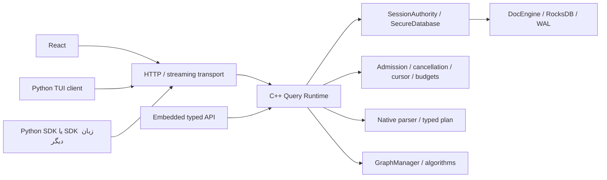

# نقشهٔ انتقال runtime از Python به C++

مبنای بررسی: سورس نامزد **۰.۵.۳** در ۲۰۲۶-۱۱-۰۵، Graphy 1.0.0 و بررسی مستقیم
کد. این سند برنامهٔ پیشنهادی بعد از انتشار IAM است؛ مراحل آینده هنوز پیاده‌سازی نشده‌اند.

پیشنهاد اصلی: ابتدا مالکیت اجرای Query، بودجه‌ها و نتیجه را در C++ یکپارچه کنیم،
سپس parser و در پایان سرور شبکه را منتقل کنیم. Python می‌تواند SDK و TUI باقی بماند؛
مقصد، امکان اجرای کامل سرور بدون interpreter پایتون است. بازنویسی TUI برای رسیدن به
این هدف لازم نیست. انتقال زبان به‌تنهایی تضمین سرعت، امنیت یا آماده‌بودن پروداکشن نیست.

## شواهد Graphy و محدودیت بررسی

اتصال MCP ابتدا گراف خالی برگرداند و جست‌وجوی بعدی پاسخ نداد؛ تحلیل قابل استفاده با
CLI محلی Graphy روی همین مخزن انجام شد. گرامر محلی C++ به علت نام‌گذاری C++ برای
توابع scanner قابل بارگذاری نبود؛ نسخهٔ tree-sitter-cpp v0.23.4 با commit
`f41e1a044c8a84ea9fa8577fdd2eab92ec96de02` با C بازسازی و ایندکس کامل تکرار شد.
این اصلاح مربوط به ابزار تحلیل محلی است و dependency محصول را تغییر نمی‌دهد.

```sh
graphy analyze --full /path/to/NexoraDB
graphy stats
graphy context Executor
graphy context QueryPipeline
graphy context ProgramResults
graphy context SecureDatabase
graphy context SessionAuthority
graphy hotspots -n 20000
```

ایندکس نهایی ۱۸٬۹۳۵ گره، ۵۹٬۷۹۲ یال و ۴۲۹ گره File گزارش کرد؛ تعداد indexed files
را ۵۲۳ اعلام کرد. این اعداد شامل تست و JavaScript تولیدشده‌اند و معیار سهم runtime نیستند.
رتبه‌های بالای bundleهای minified از نتیجه‌گیری معماری کنار گذاشته شدند.

محدودیت مهم: headerهای `.h` با گرامر C تشخیص داده شدند و بعضی parse نشدند؛
Graphy برای چند تابع پیچیدهٔ C++ مقدار cyclomatic=1 و loc=1 داد که معتبر تلقی نکردیم.
resolution میان pybind، importهای پویا، HTTP و callback کامل نیست؛ تعداد caller کم،
دلیل بلااستفاده‌بودن کلاس نیست. دادهٔ Graphy برای یافتن نقاط بررسی استفاده شد، نه
صدور حکم dead-code یا مقایسهٔ پیچیدگی Python و C++. تصمیم‌های زیر با خواندن سورس تأیید شدند.

| محل در سورس | مشاهدهٔ قابل تکرار | پیامد |
|---|---|---|
| `NexoraDB/src/nexoradb/parser/semantic.py` | ۱۴۰۹ خط؛ `Executor` دارای ۷۳ متد؛ Graphy برای `_x_Select` مقدار cyc=32/cog=82 و برای `execute_statements` مقدار cyc=14/cog=63 گزارش کرد | Python فقط parser نیست؛ dispatch، projection، ترتیب برنامه و وضعیت تراکنش/کار گراف را هم نگه می‌دارد. |
| `parser/transformer.py` در همان بسته | ۶۸۷ خط، ۱۵۰ متد transformer | نگاشت زبان به AST هنوز در Python است؛ جایگزینی lexer به‌تنهایی آن را حذف نمی‌کند. |
| `NexoraDB/src/nexoradb/execution.py` | ۴۳۳ خط؛ `QueryPipeline` با ۱۲ متد؛ Graphy `_sorted`: cyc=20 و `aggregate`: cyc=13 | sort/merge/spill و aggregation این API واقعاً Python هستند، هرچند scan/predicate بومی‌اند. این API به معنی وجود ORDER BY/GROUP BY در NexoraQL نیست. |
| `nexoradb_admin/query_program.py` | ۲۷۰ خط؛ `_rows`: cyc=23؛ `prepare`: cyc=18 | اجرای چند statement، receipt و spool نتیجه در لایهٔ HTTP مدیریت می‌شود. |
| `nexoradb_admin/query_cursors.py` | ۲۰۱ خط؛ `QueryCursorStore.page`: cyc=25 | مالکیت cursor، انقضا، replay صفحه و cleanup بخشی از Python runtime است. |
| `nexoradb_admin/execution_control.py` | ۲۵۲ خط؛ `ExecutionController` و `Cancellation` | admission و lifecycle باید با scope/budgetهای C++ یک authority مشترک داشته باشند. |
| `nexoradb_admin/idempotency.py` | ۸۵ خط؛ SQLite و `RequestJournal` | replay journal مستقل از RocksDB است؛ تبدیل زبان به‌تنهایی crash atomicity ایجاد نمی‌کند. |
| `core/security/{NativeIam,SessionAuthority,SecureDatabase}.*` | Graphy متدهای login/authorize/administer/execute را در `.cpp` یافت؛ بررسی سورس کنترل نقش، session، revocation، transaction و write batch را تأیید کرد | authority امنیتی هم‌اکنون بومی است؛ نباید دوباره در سرور یا binding جدید بازسازی شود. |
| `query/{CompiledQuery,CompiledUpdate,Evaluator,QueryMatcher}.*`، `core/*` و `graph/*` | predicate/update، RocksDB، index/FK، WAL و اجرای الگوریتم‌های گراف بومی‌اند | این زیرساخت را گسترش می‌دهیم؛ موتور تازهٔ موازی نمی‌سازیم. |

## مرز هدف



در دورهٔ انتقال، FastAPI فقط transport است و همان runtime بومی را صدا می‌زند.
pybind یک binding نازک برای API تایپ‌شده می‌ماند. پس از جایگزینی transport، نصب
Python برای سرور لازم نیست؛ SDK/TUI به‌عنوان کلاینت مستقل قابل استفاده‌اند.

قاعدهٔ توسعه از ۰.۵.۳: منطق تازهٔ consistency، permission، transaction، plan، scan،
قانون budget یا recovery در Python اضافه نشود. اعتبارسنجی ظاهری فرم و serialization
HTTP می‌تواند در Python بماند، ولی هسته باید مستقل از آنها همان درخواست را رد یا تأیید کند.

## مراحل پیشنهادی

شماره‌ها ترتیب پیشنهادی‌اند، نه وعدهٔ زمان یا دامنهٔ قطعی release. هر مرحله پس از عبور
از معیار خروج منتشر می‌شود. نسخهٔ IAM را برای این بازطراحی بزرگ نگه نمی‌داریم.

| مرحله | نسخهٔ هدف پیشنهادی | خروجی | نقش Python پس از مرحله |
|---|---|---|---|
| ۰ | ۰.۵.۳ | تثبیت IAM و قراردادهای فعلی، ثبت baseline و موارد ناسازگار | وضعیت فعلی؛ authority امنیتی بومی |
| ۱ | ۰.۵.۴ | API تایپ‌شدهٔ برنامه و resource context بومی | parser موقت + transport؛ اجرای برنامه به تدریج بومی |
| ۲ | ۰.۶.x | انتقال اجرای statementها، projection و operatorهای داده | AST/plan ورودی می‌دهد؛ حلقهٔ ردیف و sort/aggregate ندارد |
| ۳ | ۰.۷.x | cursor/session نتیجه و replay coordinator بومی | HTTP frame، status و ورودی/خروجی |
| ۴ | ۰.۸.x | parser، AST، diagnostics و plan cache بومی | Query text و parameters را به C++ می‌دهد |
| ۵ | ۰.۹.x | سرویس native با transport سازگار و shutdown بومی | سرور Python اختیاری؛ SDK و TUI مستقل |
| ۶ | پس از پذیرش مراحل قبل | حذف Python از نصب اجباری سرور و بسته‌بندی مستقل | وابستگی اختیاری کلاینت؛ حذف کامل فقط با تصمیم محصول |

### مرحلهٔ ۰: baseline و قرارداد

قرارداد missing/null، int64 در برابر double، ترتیب Unicode، duplicate key، خطای
ورودی، first-match JOIN، snapshot، commit/cancel و revoke-during-stream را از تست‌های
فعلی به corpus مستقل از زبان تبدیل کنید. نسخهٔ داده، پروتکل و نسخهٔ محصول جدا بمانند.
ایمنی IAM، root-only promotion و رد legacy constructor برای هر مسیر ورود ثابت بماند.

baselineهای کوچک و بزرگ را ثبت کنید: خواندن نقطه‌ای، scan، JOIN، برنامهٔ چنددستوری،
تراکنش، نقش/ابطال، graph projection، sort/aggregate و restart. p50/p95/p99، throughput،
CPU، RSS/cgroup peak، allocation، bytes copied، تعداد عبور از FFI و cancellation latency
را اندازه بگیرید. سهم GIL را با profiling مشخص کنید؛ فعلاً عدد عملکردی برای آن نداریم.

معیار خروج: corpus و baseline قابل اجرا با seed و build یکسان؛ ماتریس سازگاری و API
مالکیت handleها مکتوب باشد. LOC یا عدد complexity معیار موفقیت عملکردی نیست.

### مرحلهٔ ۱: runtime بومی و ownership

یک `QueryRuntime`/`ProgramRequest` تایپ‌شده روی `SecureDatabase` بسازید؛ نام‌ها در این
سند طراحی پیشنهادی‌اند. session، cancellation، deadline، query-id و memory/disk credits
در `ExecutionContext` بومی باشند. یک درخواست برنامه به C++ برسد، نه فراخوانی به ازای
هر ردیف. raw DocEngine، pointer یا پرچم «trusted/admin» از کلاینت نپذیرید.

`ExecutionController` پایتون ابتدا adapter این context شود؛ سقف سراسری، سهم هر هویت،
صف محدود و سهم maintenance در هسته باشد. توقف HTTP cancel را منتقل کند و worker
تا پایان واقعی native operation مالک منابع بماند. مهاجرت ownership تراکنش را همراه
مدل thread affinity انجام دهید، نه با جابه‌جایی آزادانهٔ handle بین workerها.

معیار خروج: برنامهٔ بومی بدون import Python با session اجرا شود؛ overload، expiry،
لغو حین commit، writer fairness و cleanup از تست C++ عبور کنند. هیچ مسیر جدیدی بودجه
یا auth را با دورزدن adapter دور نزند.

### مرحلهٔ ۲: executor و operatorها

ابتدا dispatch و ترتیب برنامه، transaction boundary، `USE GRAPH` و result/receipt
را از `Executor` و `ProgramStream` منتقل کنید. سپس projection/path lookup، LIMIT/SKIP،
JOIN output shaping و serializer دسته‌ای را به native operator منتقل کنید. از
`DocumentView`، `CompiledQuery` و snapshotهای موجود استفاده کنید؛ BSON را برای هر
ردیف به dict و دوباره JSON تبدیل نکنید. نتیجهٔ batch فقط ownership روشن داشته باشد.

sort/merge/group و SUM کنترل‌شدهٔ `execution.py` مرحلهٔ بعدی همین کار است: comparator
مشترک با query، محدودیت record، credit rounded disk blocks، checksum و spill خصوصی،
تشخیص spill ناقص و cleanup پس از SIGKILL باید حفظ شوند. اضافه‌کردن ORDER BY/GROUP BY
به زبان یک تصمیم جداست؛ API موجود را ابتدا با همان رفتار منتقل کنید.

سپس orchestration گراف را از binding خارج کنید تا مصرف‌کنندهٔ C++ نیز بدون Python
همان projection-on-commit را بگیرد. full rebuild فعلی را پس از اندازه‌گیری با delta
یا outbox سازگار ارتقا دهید؛ اتمیک‌بودن document و graph را بدون طراحی durable ادعا نکنید.

معیار خروج: تمام corpus در هر دو مسیر هم‌ارز؛ صفر loop پردازش ردیف در adapter سرور،
بودجهٔ خروجی/حافظه/دیسک مستقل از Python و sanitizer/recovery tests موفق باشد. آستانهٔ
قابل قبول p99 و حافظه را پیش از benchmark تعیین کنید؛ بهبود را پس از اندازه‌گیری اعلام کنید.

### مرحلهٔ ۳: cursor و replay

`QueryCursorStore`، registry snapshot، page sequence، quota، idle/absolute expiry و
native-session binding در runtime قرار گیرند. Python فقط frame/HTTP status بسازد.
از تحویل batch cacheشده پس از revocation جلوگیری کنید؛ چک فقط در زمان بازشدن کافی نیست.
cursor process-local را تا طراحی state مشترک، قابل جابه‌جایی میان instanceها ننامید.

`RequestJournal` و `ProgramResults` را به coordinator بومی منتقل کنید. ابتدا semantics
رزرو/unknown/reconcile را حفظ کنید. اگر journal به RocksDB منتقل شد، فقط mutationهایی
که واقعاً در همان write batch/transaction نتیجهٔ درخواست را ثبت می‌کنند crash-atomic
نامیده شوند. چند statement، graph update و external effects به طراحی مستقل نیاز دارند.
حذف SQLite یا تغییر زبان، تضمین exactly-once برای کل برنامه نمی‌دهد. مهاجرت journal
رزروهای قبلی را حفظ کند؛ clearing برای reexecute ممنوع باشد.

معیار خروج: crash در هر مرز reservation/write/receipt، replay با session جدید، token
issuer generation، spool expiry، lost response و revocation تست شود؛ duplicate write
رخ ندهد و نتیجهٔ نامعلوم به موفقیت یا اجرای مجدد تبدیل نشود.

### مرحلهٔ ۴: زبان بومی

پس از تثبیت typed plan، lexer/parser/AST و semantic validation را از Lark/transformer
منتقل کنید. grammar واحد و diagnostics دارای line/column و محل parameter بمانند.
در دورهٔ مقایسه، Python فقط AST/plan را با C++ مقایسه کند؛ دو مسیر mutation اجرا نشود.
تست grammar همهٔ دستورهای منتشرشده، quoted identifiers پشتیبانی‌شده، escapes، پارامترها،
IAM و graph/job را پوشش دهد. plan cache پارامتر و session را cache نکند؛ current policy
برای هر اجرا بازاعتبارسنجی شود. fuzz محدودیت depth/size و اعداد را اجباری کنید.

معیار خروج: endpoint تشخیص خطا و اجرای Query هر دو یک parser بومی استفاده کنند؛
Lark و AST اجرایی Python از dependency اجباری سرور حذف شوند. افزودن grammar جدید
همراه parser دوم ممنوع باشد. موارد ناسازگار فقط با release note و نسخهٔ پروتکل تغییر کنند.

### مرحلهٔ ۵ و ۶: سرویس بدون Python

HTTP/streaming، TLS یا قرارداد reverse proxy، auth binding، CORS/CSP، static assets،
metrics و signal/shutdown را به transport بومی وصل کنید. انتخاب کتابخانهٔ شبکه بعد از
prototype، بررسی نگهداری/security و benchmark باشد. ساخت HTTP parser یا crypto دستی
جزء برنامه نیست. مانیتورینگ Socket.IO فعلی باید یا سازگار پیاده شود یا با نسخه‌بندی
و adapter انتقالی، هم‌زمان React و TUI به پروتکل جایگزین مهاجرت کنند.

در پایان یک باینری مستقل `nexoradbd` و ابزار `nexora_iam` قابل نصب با service manager
عرضه کنید؛ wheel صرفاً SDK/binding اختیاری شود. React همچنان فایل static است و Python
TUI کلاینت شبکه می‌ماند. حذف کامل Python از کل محصول یعنی بازنویسی SDK/TUI و ابزارها؛
این هزینه را فقط اگر الزام توزیع محصول باشد بپذیرید، نه برای سریع‌ترکردن موتور.

معیار خروج: نصب و اجرای سرور روی میزبان بدون Python؛ قرارداد HTTP/driver/React/TUI
قبول؛ HTTPS/WSS، limitها، signal، crash/recovery، long-running soak و backup/restore
در CI مستقل از wheel اجرا شوند. Python adapter بعد از یک دورهٔ deprecation حذف شود.

## rollout و ترتیب کارهای نزدیک

هر operator با feature flag داخلی و تست هم‌ارزی منتقل شود؛ shadow فقط برای خواندن
روی snapshot یکسان یا مقایسهٔ plan باشد. هر mutation دقیقاً یک executor داشته باشد.
اول embedded/API مستقیم، سپس HTTP، بعد workloadهای بزرگ؛ default وقتی عوض شود که
کارکرد، budget و خطا در تمام مسیرها برابر باشند. downgrade پس از IAM adoption با
باینری قدیمی پشتیبانی نمی‌شود؛ rollback عملیاتی از backup پیش از ارتقا در مسیر جداست.

کارهای قابل تعریف برای اولین PRهای بعد از ۰.۵.۳:

1. corpus زبان/نتیجه و benchmark baseline مستقل از FastAPI، همراه مرز ownership.
2. `ProgramRequest` و `ExecutionContext` بومی با تست session/deadline/budget.
3. انتقال projection و statement executor با یک batch interface و binding نازک.
4. انتقال cursor/expiry و admission با مسیر cancel مشترک؛ حذف authority موازی Python.
5. operatorهای spill و coordinator durable؛ سپس parser و transport طبق مراحل بالا.

PRها کوچک و قابل rollback در سطح implementation باشند؛ در ۰.۵.۳ وارد بازنویسی
runtime نمی‌شویم. بازبینی مستقل امنیت IAM، sanitizer/fuzz و آزمون عملکرد در اندازهٔ
استقرار همچنان شرط پذیرش صنعتی هستند.
